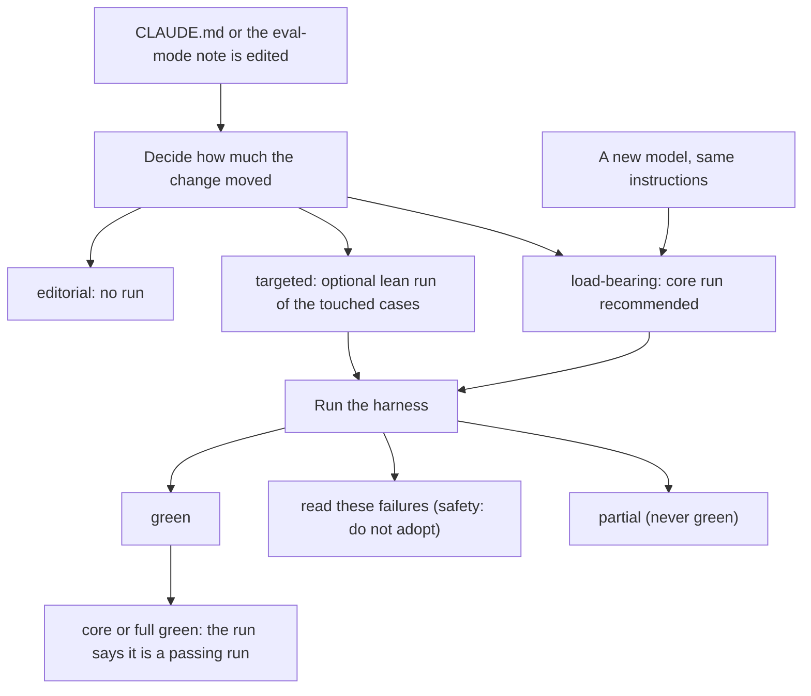
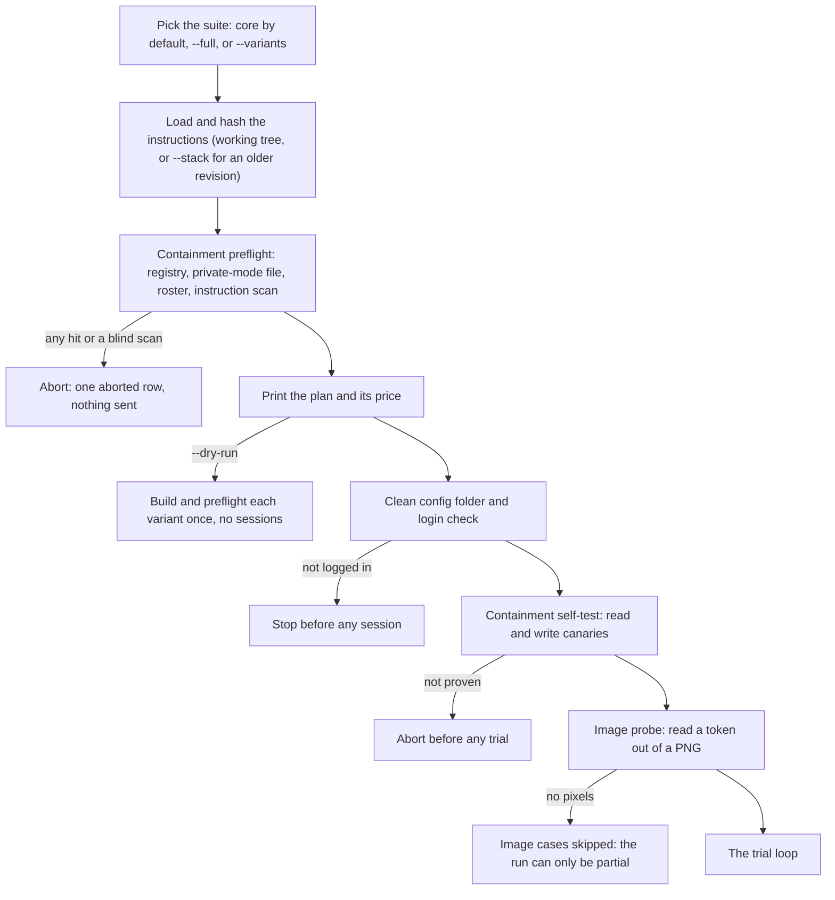
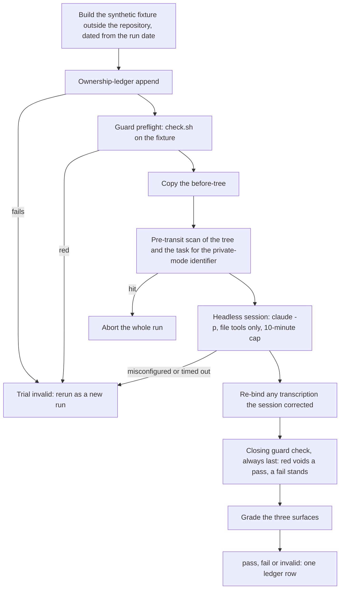
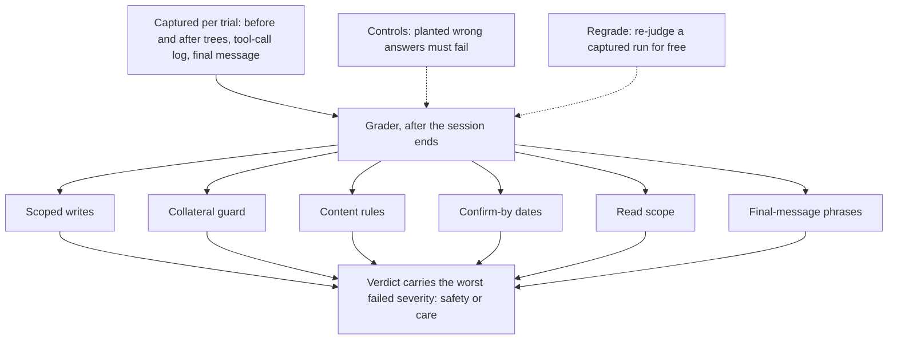

# How a run works

Read when: you change the runner's steps or gates, change the surfaces the grader checks, or need
to understand a run before its first session.

**When a run happens, and what it leaves behind:**

**Once per run: the gates.** Each fails closed:

**Once per trial, in this order:**

**Grading.** Grading is offline and deterministic, and the grader is checked without sessions:

Reading the outcome (**green**, **read these failures**, **partial**) and where the transcripts
land: [`harness/README.md`](../harness/README.md) → *Reading the result*.
